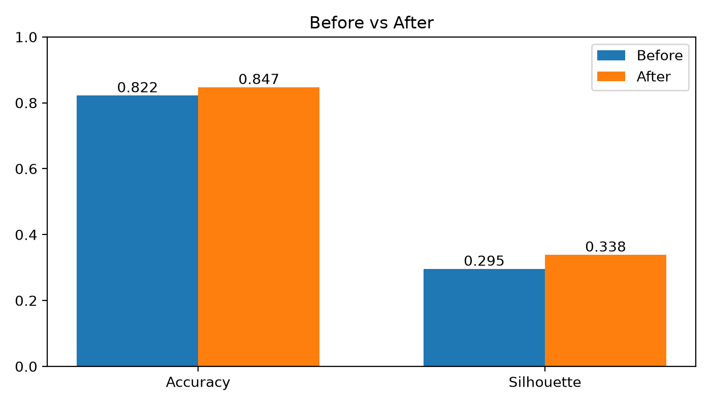
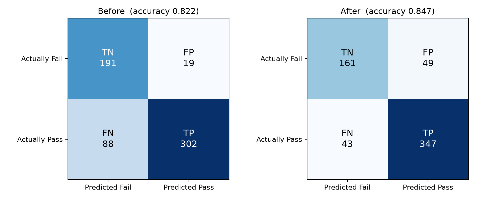
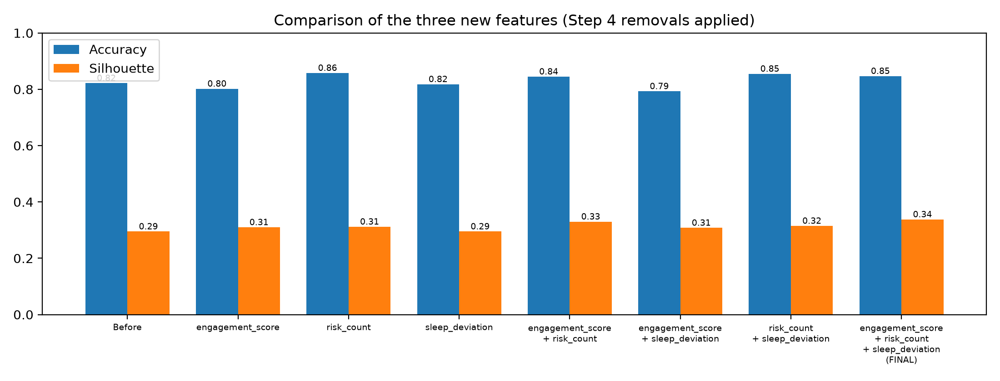

# Feature Engineering for Unsupervised Pass/Fail Clustering of Student Performance

**Author:** Los
**Keywords:** feature engineering, K-Means, clustering, student performance, silhouette score, multicollinearity, VIF

---

## Abstract

This project studies whether hand-crafted features improve an unsupervised K-Means model (k = 2) that groups students into *Pass* and *Fail* clusters. Starting from six cleaned attributes, we add three engineered features (`engagement_score`, `risk_count`, `sleep_deviation`), remove redundant columns using a correlation rule and a variance inflation factor (VIF) check, and compare the model before and after. The ground-truth label `actual` is withheld from the entire pipeline and used only for scoring. Feature engineering raises accuracy from **0.822 to 0.847** (15 more students correctly grouped out of 600) and the silhouette score from **0.295 to 0.338**, meaning the two clusters become clearer and better separated. A `log1p` transform on `absences` was tested and rejected because it did not help.

---

## Table of Contents

1. [Introduction](#1-introduction)
2. [Background](#2-background)
3. [System Architecture](#3-system-architecture)
4. [Evaluation](#4-evaluation)
5. [Conclusion](#5-conclusion)
6. [Reference](#6-reference)
7. [Reproducibility](#7-reproducibility)

---

## 1. Introduction

Predicting whether a student will pass or fail is useful for early intervention, but labelled outcomes are not always available when decisions must be made. Clustering offers a label-free alternative: group students by similarity, then inspect whether the groups line up with real outcomes.

The quality of a clustering result depends heavily on the features it receives. Raw attributes such as attendance or study hours may describe a student only partially, and highly correlated attributes can silently over-weight one aspect of behaviour. This project asks:

> **Can a small set of engineered, interpretable features, combined with removal of repeated information, make K-Means separate Pass and Fail students better than the original features alone?**

**Contributions**

- A leakage-safe pipeline in which the label `actual` is removed immediately after loading and used only for final scoring.
- Three interpretable engineered features, each with an explicit rationale.
- A two-rule procedure for removing repeated features (correlation above 0.85 and redundancy checked with VIF).
- An ablation over all seven combinations of the new features, with and without the removal step.
- A full Before vs. After comparison using confusion matrices, accuracy, precision, recall and silhouette score.

---

## 2. Background

### 2.1 K-Means clustering
K-Means partitions data into *k* clusters by repeatedly assigning points to the nearest centroid and recomputing centroids (Lloyd, 1982; MacQueen, 1967). It uses Euclidean distance, so features must be on comparable scales. Here we use `StandardScaler` and fix `k = 2`, `random_state = 42`, `n_init = 10`.

### 2.2 Cluster quality
The **silhouette score** (Rousseeuw, 1987) measures how close each point is to its own cluster compared with the nearest other cluster. It ranges from -1 to 1; higher means clearer, better-separated groups. It needs no labels, so it complements accuracy.

### 2.3 Redundant features and multicollinearity
When one feature can be rebuilt from others, it adds no new information but still pulls on distance calculations. Two checks are used:

- **Correlation threshold:** a pair with absolute correlation above **0.85** is considered repeated.
- **Variance Inflation Factor (VIF):** the VIF of a feature is `1 / (1 - R²)`, where R² comes from regressing that feature on all others. Values above about 5 indicate mostly repeated information, and `inf` indicates an exact linear copy (O'Brien, 2007).

### 2.4 Evaluating clusters against labels
Cluster ids (0/1) are arbitrary. To score them, each cluster is matched to Pass or Fail in the way that gives the higher accuracy, using the same rule for the Before and After models. **Positive = Pass**, **Negative = Fail**.

| | Predicted Fail | Predicted Pass |
|---|---|---|
| **Actually Fail** | TN | FP (Fail wrongly called Pass) |
| **Actually Pass** | FN (Pass wrongly called Fail) | TP |

---

## 3. System Architecture

### 3.1 Pipeline overview

```
students_dataset.csv
        │
        ▼
 Remove `actual`  ──────────────► kept aside (evaluation only)
        │
        ▼
 Step 1  Clean: drop duplicates, fill empty cells with the median
        │
        ▼
 Step 2  Fix wrong values: clip percentages to 0–100, hours/counts ≥ 0
        │
        ├──────────────► X_before  (6 cleaned original features)
        ▼
 Step 3  Add 3 engineered features
        │
        ▼
 Step 4  Remove repeated features (correlation rule + VIF/redundancy rule)
        │
        ▼
 Step 5  StandardScaler → K-Means (k = 2, random_state = 42)
        │
        ▼
 Evaluate against `actual`: accuracy, precision, recall, silhouette
```

### 3.2 Leakage control (Rule 1)
`actual` is popped from the dataframe right after loading and converted to a 0/1 vector (1 = Pass). No engineered feature uses it. It is attached back to a reference copy of the data only after modelling is finished.

### 3.3 Data cleaning
- Duplicate rows are removed, and the label vector is filtered with the same mask to stay aligned.
- Empty cells are filled with the column median.
- Percentage columns (`attendance_pct`, `assignments_done_pct`) are clipped to 0–100; `study_hours_per_week`, `sleep_hours` and `absences` are clipped to be non-negative.

### 3.4 Engineered features

| Feature | Definition | Rationale |
|---|---|---|
| `engagement_score` | (`attendance_pct` + `assignments_done_pct`) / 2 | Students who attend and submit work are better prepared. |
| `risk_count` | Number of warning signs: study < 2 h, attendance < 70 %, previous grade < 50, absences ≥ 10 | More warning signs suggest a higher chance of failing. |
| `sleep_deviation` | abs(`sleep_hours` − 8) | Too little or too much sleep can harm concentration. |

### 3.5 Removal of repeated features

| Removed column | Rule | Evidence |
|---|---|---|
| `assignments_done_pct` | Rule 1: correlation above 0.85 | Correlation 0.918 with `engagement_score`; VIF is infinite for `attendance_pct`, `assignments_done_pct` and `engagement_score` because the score is exactly their average. |
| `sleep_hours` | Rule 2: redundancy | `sleep_deviation` is computed only from it (correlation about −0.815, just under the 0.85 limit). |

In both cases the new feature is kept and the original is dropped. After removal, the largest remaining absolute correlation is below 0.85.

### 3.6 Final feature set
The original six features minus `assignments_done_pct` and `sleep_hours`, plus the three engineered features, giving **7 features**.

### 3.7 Clustering configuration

| Setting | Value |
|---|---|
| Scaler | `StandardScaler` |
| Algorithm | `KMeans` (scikit-learn) |
| Clusters | 2 |
| `random_state` | 42 |
| `n_init` | 10 |

---

## 4. Evaluation

All results use the same pipeline (`StandardScaler` + K-Means, k = 2, `random_state = 42`). Totals: 600 students (390 actual Pass, 210 actual Fail).

### 4.1 Before vs. After

| Metric | Before | After | Change |
|---|---|---|---|
| Accuracy | 0.822 | 0.847 | +0.025 |
| Silhouette | 0.295 | 0.338 | +0.043 |
| Precision (Pass) | 0.941 | 0.876 | −0.065 |
| Recall (Pass) | 0.774 | 0.890 | +0.116 |



### 4.2 Confusion matrix

| Count | Before | After | Change | Better when |
|---|---|---|---|---|
| TP | 302 | 347 | +45 | higher |
| TN | 191 | 161 | −30 | higher |
| FP | 19 | 49 | +30 | lower |
| FN | 88 | 43 | −45 | lower |
| **Correct (TP + TN)** | **493** | **508** | **+15** | higher |



**Interpretation.** Before engineering, the model was cautious about calling anyone Pass (high precision, low recall). After engineering it finds many more passing students (FN 88 → 43) at the cost of wrongly labelling more failing students as Pass (FP 19 → 49). The net effect is 15 additional correct students and a more balanced precision/recall trade-off.

### 4.3 Ablation: which new feature helps?

Each combination of the new features was tested with the Step 4 removals applied automatically.

| Feature set | Accuracy | Silhouette |
|---|---|---|
| Before (original 6) | 0.822 | 0.295 |
| `engagement_score` only | 0.802 | see CSV |
| `sleep_deviation` only | 0.818 | see CSV |
| `risk_count` only | 0.858 | see CSV |
| `risk_count` + `sleep_deviation` | 0.855 | 0.315 |
| **All three (FINAL)** | **0.847** | **0.338** (highest) |

*Full results for every combination, with and without removals, are in `comparison_three_features.csv`.*



**Findings**

- `engagement_score` (0.802) and `sleep_deviation` (0.818) alone do not beat the Before accuracy (0.822).
- `risk_count` is the strongest single feature (0.858).
- All three together give the clearest clusters (silhouette 0.338), so the final set optimises cluster separation rather than raw accuracy.

### 4.4 Sleep columns: keep both or drop `sleep_hours`?

| Choice | Accuracy | Silhouette |
|---|---|---|
| Keep both `sleep_hours` and `sleep_deviation` | 0.848 | 0.308 |
| **Drop `sleep_hours` (FINAL)** | 0.847 | 0.338 |

Accuracy is essentially unchanged, but dropping the redundant column yields clearer groups.

### 4.5 Effect of `np.log1p` on `absences`

`absences` is only mildly skewed (skew about 0.27); `log1p` over-corrects it to about −1.06.

| Dataset | Accuracy without log | Accuracy with log | Silhouette without log | Silhouette with log |
|---|---|---|---|---|
| Before | 0.822 | 0.773 | see CSV | see CSV |
| After | 0.847 | 0.847 | 0.338 | 0.319 |

The transform lowered accuracy on the Before data and lowered the silhouette on the After data, so it is **not** used in the final dataset.

### 4.6 Threats to validity

- **Label matching uses `actual`.** Cluster ids are assigned to Pass/Fail by choosing the higher-accuracy mapping, which makes accuracy slightly optimistic for both models equally.
- **Single dataset, single seed.** Results use one dataset and `random_state = 42`; stability across seeds and datasets was not tested.
- **Hand-chosen thresholds.** The `risk_count` cut-offs (2 h, 70 %, 50, 10 absences) were set by judgement, not tuned.
- **Precision trade-off.** Accuracy and silhouette improve, but precision on Pass falls, so the After model is not uniformly better.

---

## 5. Conclusion

Interpretable feature engineering, combined with removal of repeated information, improved unsupervised Pass/Fail clustering on the student data: accuracy rose from 0.822 to 0.847 and silhouette from 0.295 to 0.338, with 15 more students grouped correctly. The ablation shows that no single new feature is best on every measure: `risk_count` gives the top accuracy alone, while the combination of all three gives the clearest clusters. Removing `assignments_done_pct` and `sleep_hours` eliminated exact and near-exact duplication without hurting accuracy, and the `log1p` transform on `absences` was not beneficial.

**Future work:** test multiple random seeds and other clustering algorithms (e.g., Gaussian mixtures); tune the `risk_count` thresholds; validate on a second cohort; and report results in terms of the cost of false Pass versus false Fail decisions.

---

## 6. Reference

1. MacQueen, J. (1967). Some methods for classification and analysis of multivariate observations. *Proceedings of the Fifth Berkeley Symposium on Mathematical Statistics and Probability*, 1, 281–297.
2. Lloyd, S. P. (1982). Least squares quantization in PCM. *IEEE Transactions on Information Theory*, 28(2), 129–137.
3. Rousseeuw, P. J. (1987). Silhouettes: A graphical aid to the interpretation and validation of cluster analysis. *Journal of Computational and Applied Mathematics*, 20, 53–65.
4. O'Brien, R. M. (2007). A caution regarding rules of thumb for variance inflation factors. *Quality & Quantity*, 41(5), 673–690.
5. Pedregosa, F. et al. (2011). Scikit-learn: Machine learning in Python. *Journal of Machine Learning Research*, 12, 2825–2830.
6. McKinney, W. (2010). Data structures for statistical computing in Python. *Proceedings of the 9th Python in Science Conference*, 56–61.
7. Harris, C. R. et al. (2020). Array programming with NumPy. *Nature*, 585, 357–362.

---

## 7. Reproducibility

**Requirements:** Python 3, `numpy`, `pandas`, `matplotlib`, `scikit-learn`, `jupyter`

```bash
pip install numpy pandas matplotlib scikit-learn jupyter
jupyter notebook feature_engineeringV3.ipynb
```

Place `students_dataset.csv` in the same folder as the notebook, then run all cells.

**Generated outputs**

| File | Description |
|---|---|
| `students_dataset_engineered.csv` | Final features only (what K-Means saw) |
| `students_dataset_engineered_scaled.csv` | Standardized version of the final features |
| `students_dataset_engineered_with_actual.csv` | Final features plus `actual`, for reference only |
| `before_after_comparison.csv` | Summary of all scenarios |
| `comparison_confusion_matrix.csv` / `.png` | Confusion matrix counts and plot |
| `comparison_metrics.csv` | Accuracy, precision, recall, silhouette |
| `comparison_log1p.csv` | Effect of `log1p(absences)` |
| `comparison_three_features.csv` / `.png` | Ablation over the new features |
| `correlation_matrix.csv` / `.png` | Correlation matrix of all features |
| `comparison_accuracy_silhouette.png` | Before vs. After bar chart |
| `comparison_table.png` | Summary table image |
